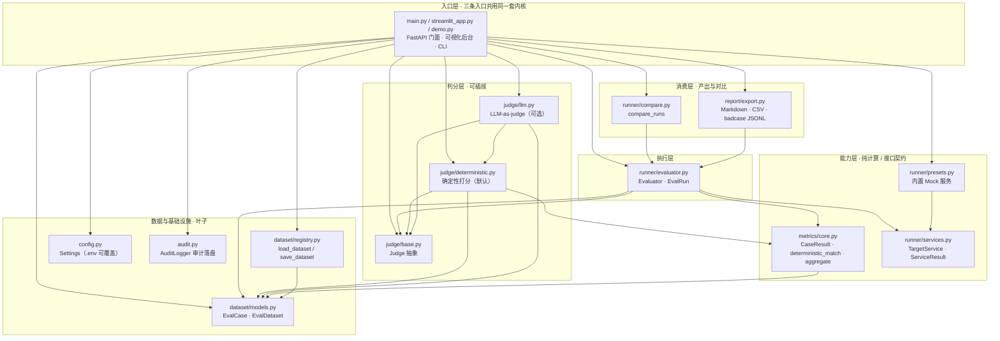

# 架构｜enterprise-ai-eval-harness

## 总体链路
```
评测数据集(JSON)
   → 任务分发（按场景 rag/sql/agent 过滤）
   → 目标服务适配器（TargetService.answer）
   → 确定性判分（数值/文本/拒答）+ 可选 LLM-as-judge
   → 指标聚合（准确率/拒答率/误拒/漏拒/召回…）
   → badcase 归档（JSONL）+ 报表导出（Markdown/CSV）
   → 版本对比（base vs candidate）
```

## 模块划分
| 模块 | 职责 |
|---|---|
| `dataset` | 评测用例/数据集模型与 JSON 读写 |
| `metrics` | 文本归一化、数字提取、关键片段召回率、确定性判分、指标聚合 |
| `judge` | 打分器抽象：确定性判分（默认）、LLM-as-judge（可选 litellm） |
| `runner` | 目标服务抽象与模拟服务、评测执行器、版本对比、内置服务预设 |
| `report` | Markdown 验收报表、版本对比报表、CSV/JSONL 导出 |
| `audit` | 评测任务审计（JSONL + 内存环形缓冲） |
| `main` | FastAPI 接口 + Harness 门面 |
| `streamlit_app` | 可视化后台（跑评测 / 版本对比 / 评测集 / badcase） |

## 模块依赖图

按**真实 import 关系**绘制（箭头 = 依赖方向，`A → B` 表示 A import B）。GitHub 原生渲染 Mermaid，增删模块时请同步更新本节。



> 说明：`judge/deterministic.py → metrics/core.py` 是函数内的延迟导入，仍计入依赖；各包 `__init__.py` 只做 re-export，`examples/adapter_example.py` 属于仓库外接入示例，均不在图内。

### 依赖不变量（改动时一并守住）

1. **`metrics/core.py` 不 import 任何 `judge/*`**：确定性判分主路径与 LLM 完全解耦，离线、可复现、可单测。
2. **`runner/evaluator.py` 只依赖 `judge/base.Judge` 抽象**：具体实现由入口层启动时注入（`main._make_judge()`），属于依赖倒置；新增打分器不需要改执行器。
3. **`dataset/models.py` 是纯 dataclass 叶子**：无 IO、无框架依赖；`config.py` / `audit.py` / `runner/services.py` 同为叶子。
4. **整张图是 DAG，无循环依赖**：每层都能单独单测，38 个 pytest 不需要起服务、不需要外网。
5. **`streamlit_app.py` 是唯一使用绝对导入的模块**：Streamlit 把它当独立脚本执行（没有 `__package__`），因此开头做 `sys.path` 自举，其余模块一律相对导入。这正是 `tests/test_streamlit_app.py` 用 AST 全文件扫描禁止相对导入、并用 `AppTest` 真点一次主按钮的原因。

### 扩展点

接入真实 RAG / Text2SQL / Agent 服务时，只需在 `runner/services.py` 的 `TargetService` 上实现 `answer(question) -> ServiceResult`，把被评测系统的「拒绝 / 拦截」状态映射到 `ServiceResult.refused`。判分层、指标层、报表层均无需改动 —— 这也是 `semantic-sql-guard` 能直接用它跑 Text2SQL 回归评测的原因。

## 关键设计
- **确定性优先**：默认走确定性判分（数值容差 / 文本归一化 / 拒答判定），离线、可复现、可单测；
  LLM-as-judge 作为可选增强，未配置或解析失败自动回退，保证评测不中断。
- **客观指标与主观打分分离**：业务准确率、拒答/误拒/漏拒为客观可算指标；judge 均分为 LLM 主观指标，分开展示。
- **基线可比性**：固定 judge 模型 + 固定打分 prompt（见 `config.judge_prompt`），避免换裁判导致基线漂移。
- **合规风险单列**：`expect_refuse` 用例用于校验「该拒答的必须拒答」（漏拒）与「不该拒答的不乱拒」（误拒），
  越权/敏感场景的漏拒会被单列为风险，而不是简单算进准确率。

## 与 semantic-sql-guard 联动
把 semantic-sql-guard 的 `/ask` 接口封装成 `TargetService`（见 `examples/adapter_example.py`），
即可用它跑 Text2SQL 准确率与漏拒评测，失败 case 自动回流。
